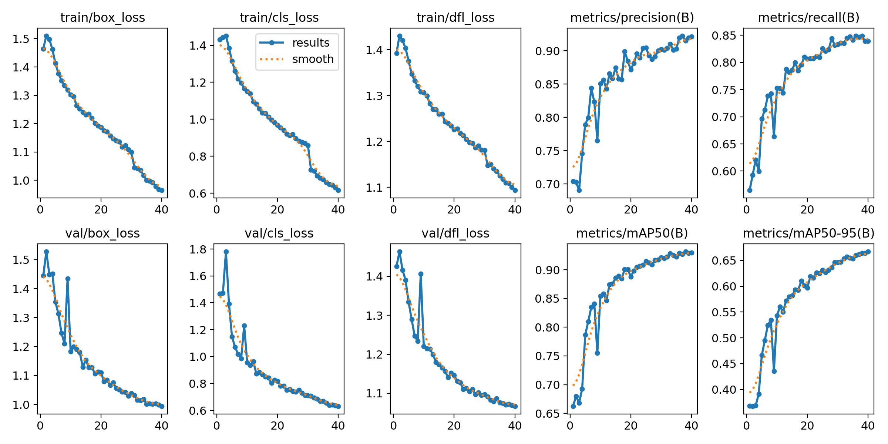
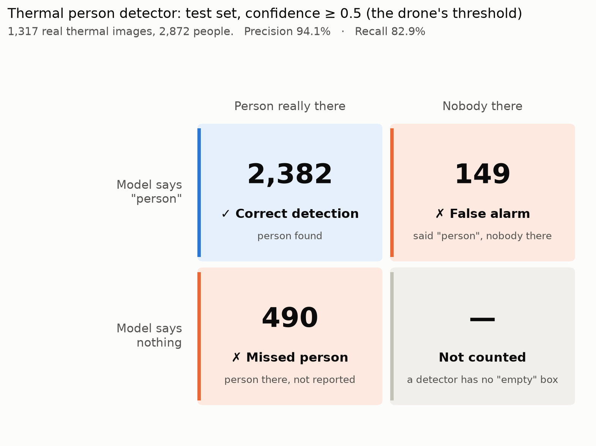
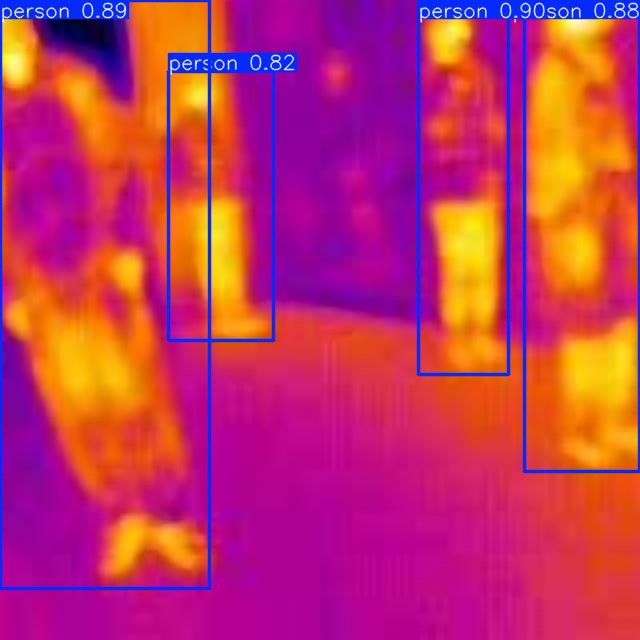
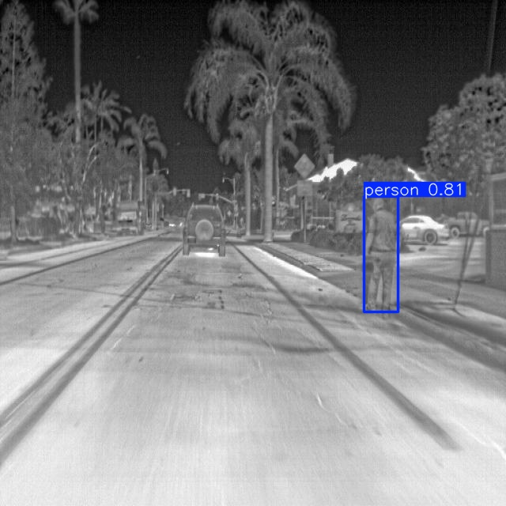
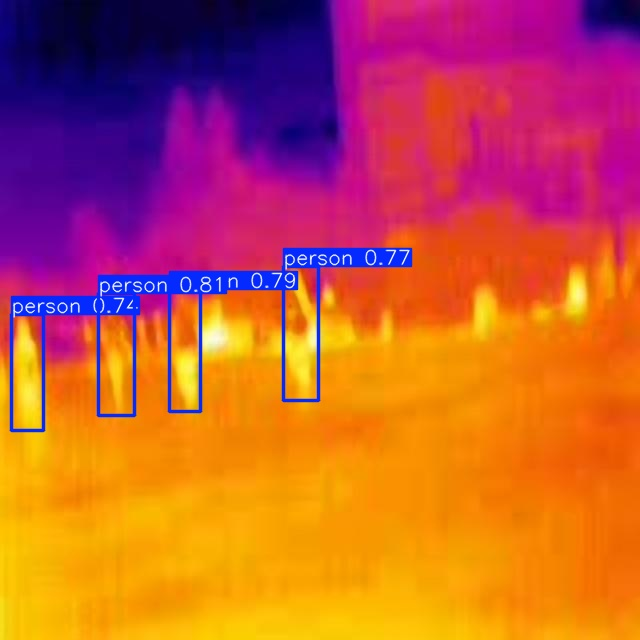
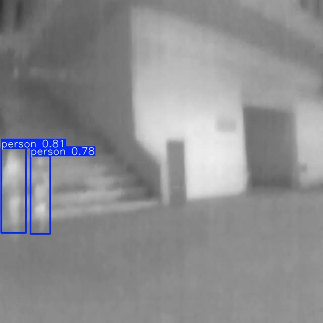
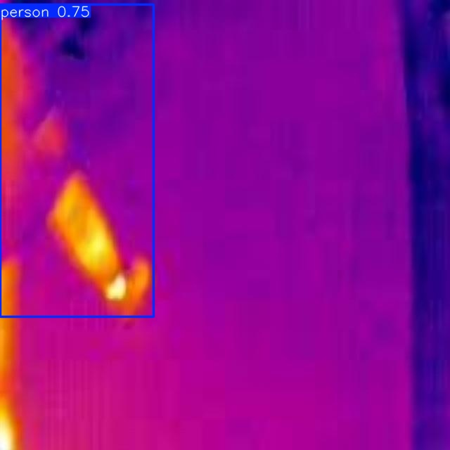

# AI model report: thermal person detector

**Team Hrika · Aeroday hackathon · Protection Civile challenge**

> **In one sentence:** we fine-tuned a small YOLOv8n detector on 8,778 real thermal images. On 1,317 test images it had never seen, it finds people with **94 % precision and 83 % recall** at the drone's confidence threshold, against **29 % recall** for the same model before thermal training. It is **6.5 MB**, small enough for a drone's onboard computer.

---

## 1. Goal

In a factory fire, smoke hides people from normal cameras and from firefighters. Our scout drone flies in first. Its **thermal camera** sees body heat through smoke, and an **AI person detector** finds trapped people and places them on the Protection Civile's live map.

The model's job: **given one thermal image, draw a box around every person in it.**

What matters most, in this order:
1. **Not missing people (recall).** A missed person may be left behind.
2. **Not raising false alarms (precision).** Every false alarm costs rescue time.
3. **Speed and size.** It must run on the drone itself, not on a distant server.

## 2. Model and why we chose it

**YOLOv8n** ("nano"), from Ultralytics, is a one-stage object detector: one pass through the network gives all the boxes at once.

| | YOLOv8n (our model) |
|---|---|
| Parameters | 3.14 million |
| Computation | 8.7 GFLOPs per 640 × 640 image |
| Weights file | 6.5 MB |
| Classes | 1 (`person`) |

**Why YOLOv8n:**
- **Small and fast enough for a drone.** The smallest YOLOv8 model, built for edge devices: phones and small embedded boards like the ones that fit on a drone.
- **Real-time.** One pass per image, with no separate "propose regions, then classify" step.
- **A good starting point.** It is pretrained on COCO (everyday photos, including the class "person"), so it already knows what a human shape looks like. We only have to teach it what a person looks like **in heat**: transfer learning.
- **Simple, well-documented training and evaluation,** which matters in a 20-hour hackathon.

Bigger models (YOLOv8s/m) would likely be a bit more accurate, but 3–10× heavier. For a drone, a light model that runs on board beats a heavy one that needs a link to a server, which a burning building may not allow.

## 3. Dataset

| | |
|---|---|
| Source | [`Voxel51/Thermal-Person-Detector`](https://huggingface.co/datasets/Voxel51/Thermal-Person-Detector) on Hugging Face, loaded with FiftyOne |
| Images | **8,778 real thermal images** |
| Labels | **18,695 boxes**, one class: `person` (about 2.1 people per image) |
| Content | Thermal images rendered both in false colours and in greyscale, with people at different distances, alone or in groups |

**Split** (random, seed 42):

| Split | Images | Used for |
|---|---|---|
| Train | 6,145 (70 %) | Learning |
| Validation | 1,316 (15 %) | Choosing the best epoch |
| **Test** | **1,317 (15 %)** | **Final scores only.** Never seen during training or epoch selection. It contains 2,872 people, and 97 images have nobody. |

All the numbers in section 5 come from the **test** set.

## 4. Training

| Setting | Value |
|---|---|
| Starting weights | `yolov8n.pt` (COCO-pretrained) |
| Epochs | 40 (early stopping: patience 10, never triggered) |
| Image size | 640 × 640 |
| Batch size | 16 |
| Seed | 42 |
| Augmentation | Ultralytics defaults (mosaic, flips, scale and colour changes); mosaic turned off for the last 10 epochs |
| Hardware | Google Colab, NVIDIA Tesla T4 |
| Training time | **65 minutes** |
| Software | Ultralytics 8.4.216 |

Code: [`train.ipynb`](train.ipynb) (with the real outputs of the run), [`evaluate.py`](evaluate.py), [`confusion_at_0.5.py`](confusion_at_0.5.py).



The losses go down smoothly on both the training and validation sets, and the scores go up. The scores were **still rising at epoch 40**, so a longer training would probably improve them (see *Next steps*). The step at epoch 30 is the moment mosaic augmentation is turned off, which is expected.

## 5. Results (test set, 1,317 images)

### 5.1 Main scores, and what thermal training adds

| | **Our model** | YOLOv8n before thermal training |
|---|---|---|
| Precision | **92.1 %** | 59.1 % |
| Recall | **85.4 %** | 28.8 % |
| **mAP@50** | **93.8 %** | 34.9 % |
| mAP@50-95 | **67.2 %** | 20.6 % |

*Precision and recall here are at the confidence that gives the best balance between the two, as Ultralytics reports them. Section 5.2 gives them at the drone's own threshold.*

- **Thermal training is what makes it work.** The same model, trained only on normal photos, finds fewer than 1 person in 3 on thermal images. Ours finds about 6 in 7, and mAP@50 goes from 35 % to 94 %.
- **No overfitting to the validation set.** The test mAP@50 (93.8 %) is as good as the validation one (93.0 %).
- **mAP@50-95 is lower (67 %)** because it also demands very precise box edges. For a rescue drone, "there is a person here" matters more than a pixel-perfect box.

### 5.2 Confusion matrix at the drone's threshold (confidence ≥ 0.5)

The drone reports a person only when the model is at least 50 % confident. These are the counts at that threshold:



| | Count | Meaning |
|---|---|---|
| Correct detections | 2,382 | |
| False alarms | 149 | **Precision 94.1 %**: about 1 alert in 17 is wrong |
| Missed people | 490 | **Recall 82.9 %**: about 1 person in 6 is missed **in a single image** |

A detector has no "true negative" count (it draws boxes around people; it cannot count empty areas), so that cell is left empty.

*Note:* Ultralytics' default confusion matrix ([`results/confusion_matrix_all_guesses.png`](results/confusion_matrix_all_guesses.png)) counts every guess down to 0.1 % confidence, which it needs to compute mAP. It shows about 21,000 "false persons" that the drone would never report, so we do not use it to describe the drone's behaviour.

### 5.3 Example detections (test images, confidence ≥ 0.5)

| | | |
|---|---|---|
|  |  |  |
|  |  | |

The model works on both false-colour and greyscale thermal images, and finds small, distant people (example 4: two people at 0.78 and 0.81 confidence).

### 5.4 Speed and size

| Hardware | Time per image (640 × 640) | Images per second |
|---|---|---|
| NVIDIA T4 GPU (Colab) | 4.2 ms (inference only) | about 240 |
| Colab CPU (no GPU) | 147 ms | **6.8** |

Even on a weak cloud CPU with no GPU, the model handles about 7 images per second, which is enough for a slow indoor flight. Small embedded AI boards with a GPU are expected to be much faster, but **we did not measure one**: that is a next step.

## 6. How it is used in our product, and what the demo shows

**In the real product:** the drone's thermal camera sends images to this model on board. Each person found is placed on the Protection Civile's live map, and the drone tells them, through its speaker, the safest exit and that the Protection Civile is on its way. The evacuation plan flags them *rescue first*.

**In the live demo, we say it openly:**
- **We have no thermal camera.** The laptop webcam stands in for it ([`vision/fake_thermal.py`](../vision/fake_thermal.py)).
- **The webcam uses the original YOLOv8n** (trained on normal photos), because the webcam films normal colour images. Once a person is found, the image is recoloured so that it *looks* thermal.
- **This trained thermal model is not what runs in the live demo.** It is the model that would run on the real drone, and it was **trained and tested on real thermal images**: every number in this report comes from real thermal data.

## 7. Limits

We prefer to state them clearly:

1. **The split is random, image by image.** The images likely come from video sequences, so near-identical frames can land in both train and test. This makes the scores **optimistic**. A split by sequence would be more honest (next step).
2. **The dataset is not a fire scene.** It has people in thermal images, but no factory interiors, no fire and no smoke. A real fire adds very hot objects (flames, hot machines, hot smoke) that could cause false alarms or hide people. We have not tested this.
3. **About 1 person in 6 is missed in a single image.** A flying drone sees the same person in many images, which should catch most of them, but we have not measured that.
4. **People partly hidden** (behind machines, lying under debris) are probably harder than in this dataset.
5. **Speed was measured on Colab,** not on drone hardware.
6. **The live demo uses a webcam,** not a thermal camera (section 6).

## 8. Next steps

1. **Train longer** (80–100 epochs): the scores were still rising at epoch 40.
2. **Split by video sequence** to get honest scores on truly new scenes.
3. **Add fire-scene data:** thermal images of factories, hot machines and smoke, including "hard negatives" (hot objects that are not people).
4. **Track people across frames** (count a person once they are seen in several images) to raise recall and stop repeated alerts.
5. **Export the model** (ONNX / TensorRT), try smaller input sizes (320–416 px), and **measure it on a real embedded board.**
6. **Add a second class, fire / hot spot,** so the drone also maps where the fire is.

## 9. Reproduce

1. Open [`train.ipynb`](train.ipynb) in Google Colab with a T4 GPU and run cell 1 (training, about 1 hour).
2. Run cells 2 and 3 (evaluation and confusion matrix at 0.5).
3. The trained weights are in [`weights/best.pt`](weights/best.pt), and every number above is in [`results/metrics.json`](results/metrics.json) and [`results/confusion_at_0.5.json`](results/confusion_at_0.5.json).

```python
from ultralytics import YOLO
model = YOLO("ai/weights/best.pt")
model.predict("thermal_image.jpg", conf=0.5, save=True)
```
